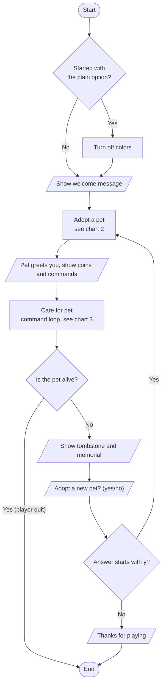
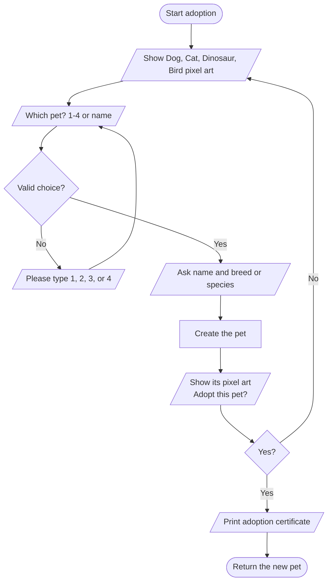
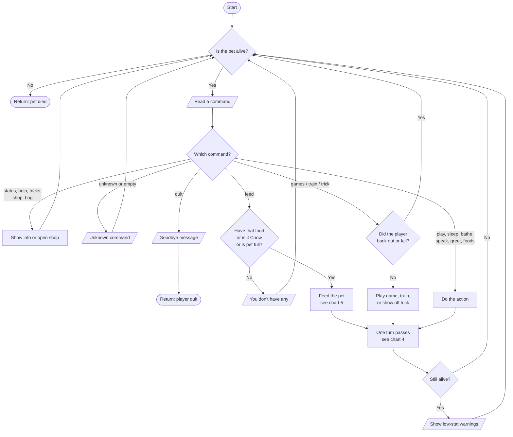
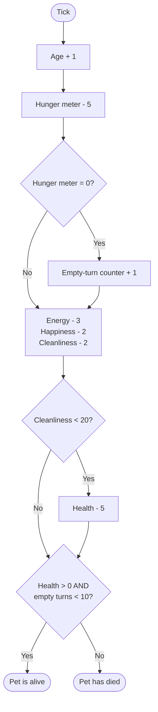
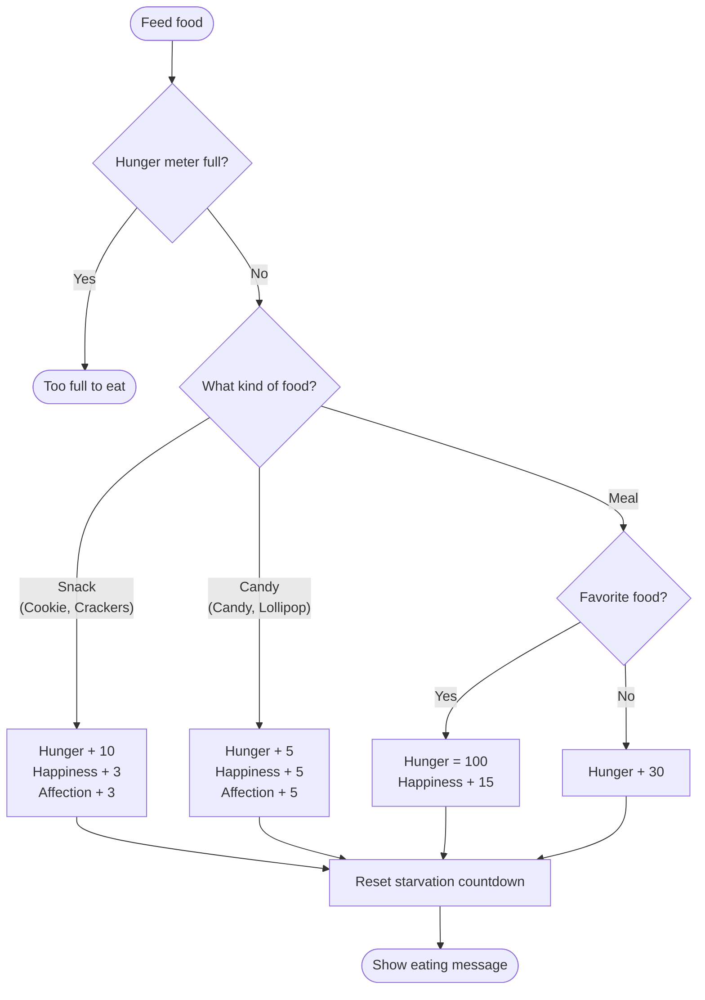
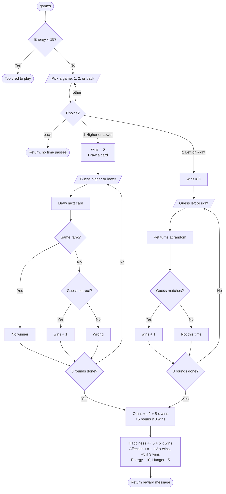
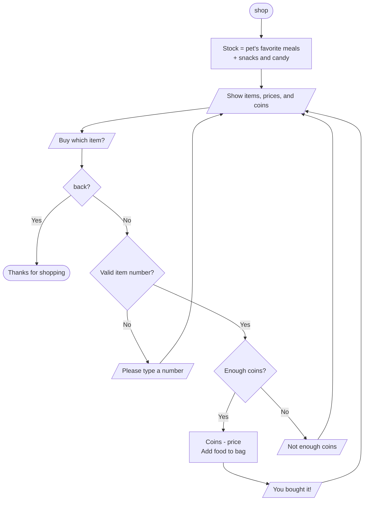
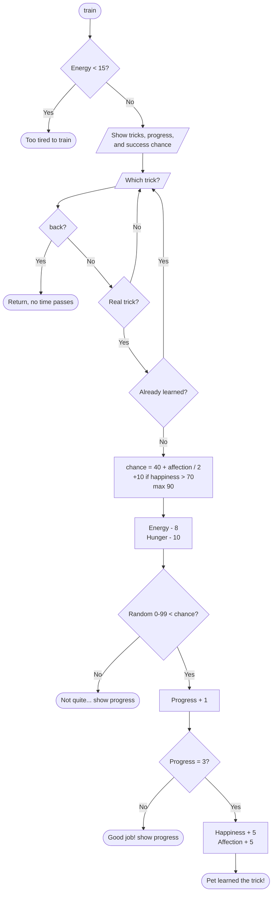

# Virtual Pet: Flowcharts

These flowcharts show how the Virtual Pet game works. They match the pseudocode in [Pseudocode.md](Pseudocode.md).

The charts are written in [Mermaid](https://mermaid.js.org/), which GitHub and IntelliJ's Markdown preview draw as pictures. To save one as an image, paste its code into <https://mermaid.live> and export it as PNG or SVG.

Shapes: rounded box = start/end, rectangle = a step, diamond = a decision, slanted box = input/output.

**Change log**

| Date       | Changes |
|------------|---------|
| 2026-11-06 | Created flowcharts for the whole game. |

---

## 1. Overall game flow (`VirtualPetGame.run`)

## 2. Adopting a pet (`adoptPet`, `pickAnimal`)

## 3. Command loop (`careForPet`)

## 4. One turn passing (`Pet.tick`, `Hunger.tick`, `isAlive`)

## 5. Feeding (`Pet.feed`)

## 6. Mini-games (`Games`)

## 7. The shop (`Store.visit`)

## 8. Trick training (`Training.train`, `Pet.practiceTrick`)

